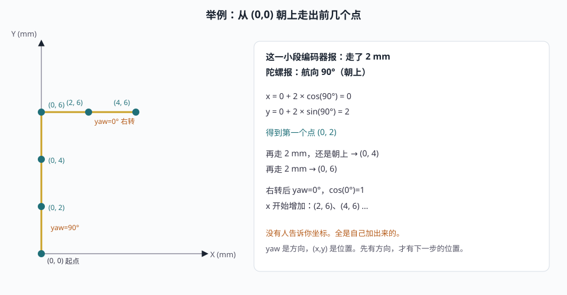
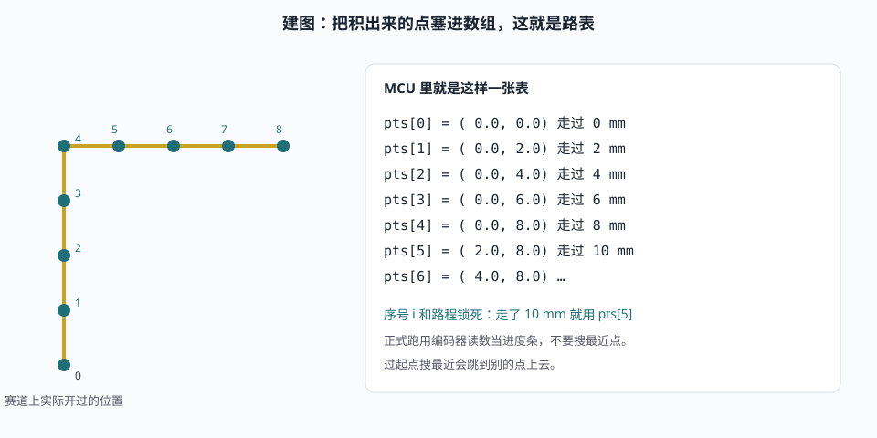
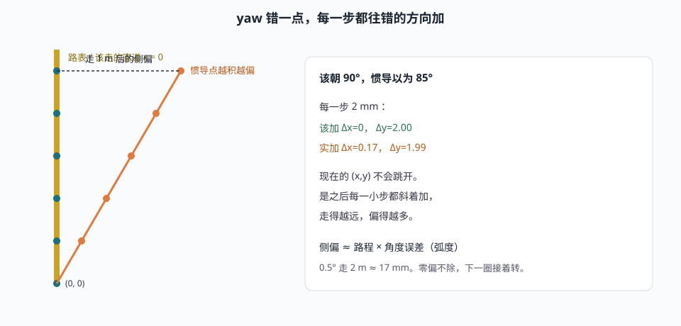
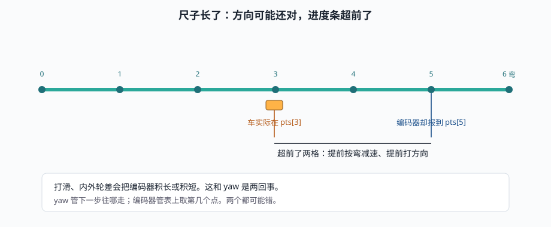
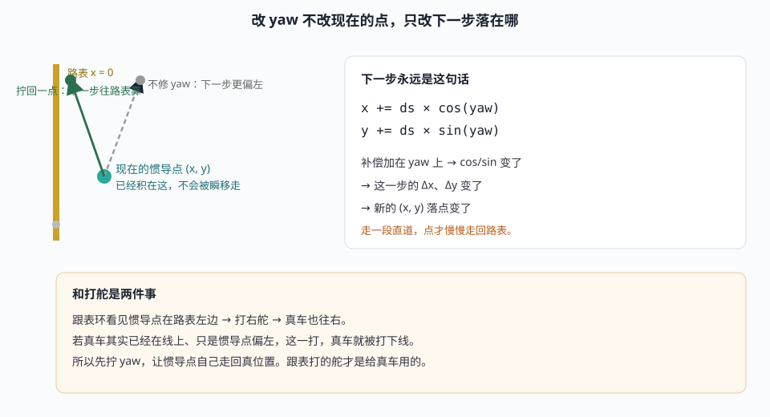
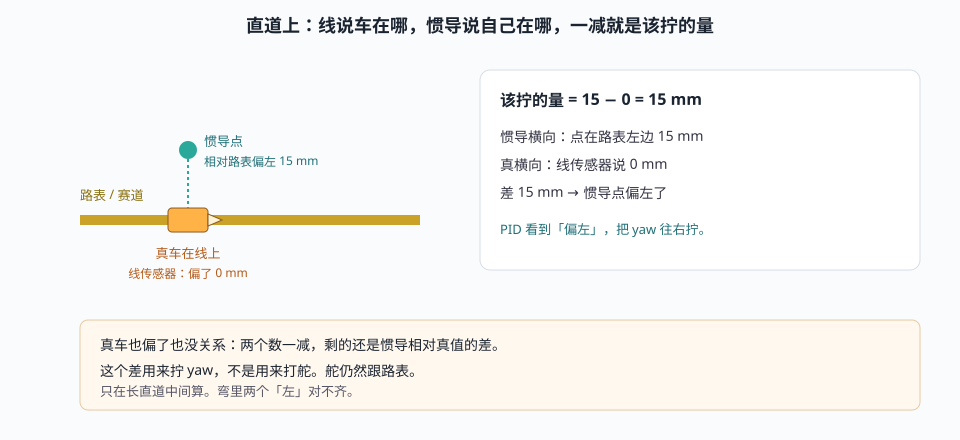
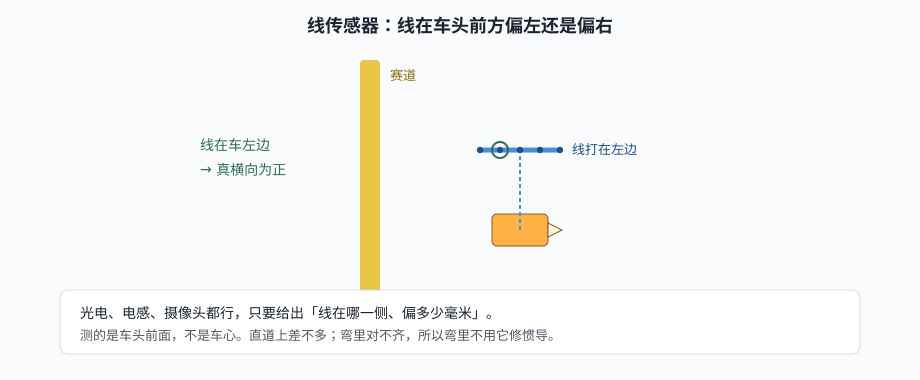
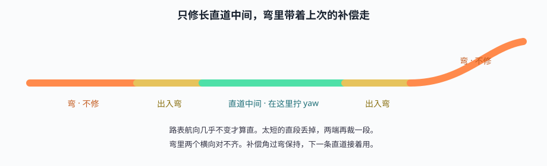
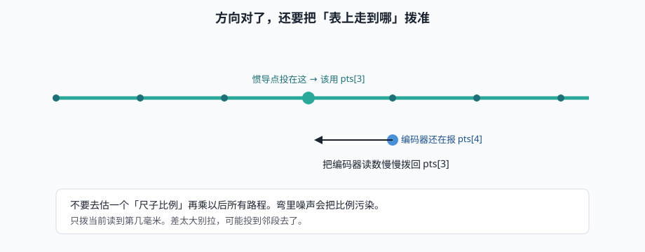

# 惯导跟表，直道把惯导拽回来

比赛车上没有 GPS，不知道自己在场地的哪一个坐标。能用的只有两样：

- **编码器**：这一小段轮子滚了多远（路程 `ds`）
- **陀螺**：车头现在朝哪（航向 `yaw`）

每走一小段，用「朝哪 × 走多远」算出新的 `(x, y)`。一路加下去，就是惯导。建图时把这些点存下来，就是路表。正式跑时按这张表开车。

线（光电 / 电感 / 摄像头）建图时用来稳稳贴线；正式跑时不再打方向，只在长直道上告诉你：惯导是不是歪了。歪了就拧一下惯导的 `yaw`。`yaw` 一变，后面积出来的 `(x, y)` 才会慢慢走回来。

---

## 1. `(x, y)` 是怎么算出来的

起点随便定，一般就当 `(0, 0)`，车头朝上，`yaw = 90°`（和数学一样：0° 朝 +X，逆时针为正）。

假设这一小段编码器说走了 **2 mm**，陀螺说航向还是 **90°**（没转弯）：

```text
x_新 = x_旧 + 2 × cos(90°) = 0 + 2 × 0 = 0
y_新 = y_旧 + 2 × sin(90°) = 0 + 2 × 1 = 2
```

惯导点从 `(0, 0)` 变成 `(0, 2)`。再走 2 mm、还是朝上，就变成 `(0, 4)`。开始右转、`yaw` 变成 0°，点就开始往 +X 走。

车上没有人告诉你「现在是 (30, 80)」。这个数完全是自己一步步加出来的。



记住一件事：**已经积出来的点不会自己改。** 你改的永远是「下一小段往哪走」。

---

## 2. 建图：这些点怎么变成一张表

建图圈：低速、贴线。舵还是用线来打，惯导只负责记账。

编码器每走过一小段（比如 2 mm），就把 **当前惯导的 `(x, y)`** 往数组里塞一个：

```text
走过 0 mm   →  pts[0] = ( 0.0,  0.0)
走过 2 mm   →  pts[1] = ( 0.0,  2.0)
走过 4 mm   →  pts[2] = ( 0.0,  4.0)
走过 6 mm   →  pts[3] = ( 0.0,  6.0)
开始右转……
走过 8 mm   →  pts[4] = ( 1.4,  7.4)
走过 10 mm  →  pts[5] = ( 3.4,  8.0)
……
回到起点附近，收表。
```

这张表就是路表。不是场地图纸，是「我自己开过去时，惯导认为走过的点」。

点的序号和路程是对上的：走了 10 mm，就该用 `pts[5]`。正式跑时用编码器读数当进度条，不要去搜「离我最近的那个点」——过起点会跳。



表里不用存航向。相邻两点一减，就是那段路朝哪。前瞻点也是沿这张表再往前数几个，不是沿车头伸出去——头已经偏了，沿车头看会越瞄越歪。

建图尽量慢、少丢线。表本身带一点偏没关系，后面矫正对准的就是这张表。

---

## 3. 正式跑：假装自己坐在惯导点上

控制器看不见车实际在哪，只看得见：

- 惯导现在的 `(x, y)`、`yaw`
- 路表上的点
- 编码器说走到第几毫米了

所以它当自己坐在惯导点上：用路程取出表上当前段，再沿表往前取一个点，看这个点在「惯导车」的左边还是右边，当转向误差。速度也按表上的弯来规划。

惯导点会努力贴路表。如果惯导其实已经歪了，真车就会被打下线——舵是按错的世界打的。

---

## 4. `yaw` 错了，`(x, y)` 会怎样

`yaw` 是下一步的方向。它错了，不是位置立刻跳开，而是 **之后每一小步都往错的方向加**。

直道本该朝 90° 走。陀螺零偏让惯导以为自己朝 85°。每走 2 mm：

```text
该加：(0.0, 2.0)     ← 纯朝上
实加：(0.17, 1.99)   ← 带了一点向右
```

走 1 m 之后，侧偏大约是 路程 × 角度误差（角用弧度）：

```text
0.5° ≈ 0.0087 弧度
走 2 m → 侧偏 ≈ 17 mm
```

看起来像整张地图慢慢转了一个角。零偏不除，下一圈接着转。



编码器给错是另一回事：方向可能还对，但「表上走到哪」错了。几何上才到 `pts[100]`，编码器已经报到 `pts[120]`，弯前就会提前减速、提前瞄弯。



---

## 5. 修正 `yaw` 和 `(x, y)` 到底什么关系

这是整件事的核心。

**不直接改 `(x, y)`。** 现在这个点已经积在那里了，没有 GPS 能告诉你该瞬移到哪。能改的是用来算下一步的那个角：

```text
用来积分的 yaw = 陀螺积出来的 yaw + 补偿角

下一步：
x = x + ds × cos(yaw)     ← yaw 变了，这一步的落点就变了
y = y + ds × sin(yaw)
```

比如惯导点现在在路表左边 15 mm。不修，下一步还是斜着往左加，会更歪。把 `yaw` 往右拧几度，下一步就带一点「往右」的分量，点一点点走回路表。走一段直道，`(x, y)` 才回到该在的地方。

舵仍然由跟表环打。跟表环看的是惯导点相对路表偏左还是偏右：

- 惯导点在表左边 → 打右舵 → **真车**也往右
- 若真车其实已经在线上、只是惯导点偏左，这一打，真车就被打下线

所以要先让惯导点走回真位置。真位置对了，跟表打的舵才是给真车用的。



补偿角过弯带着走，不要每个弯清零。丢线就冻结。输出限幅，防止传感器闪一下把航向拧飞。

---

## 6. 直道上怎么知道 `yaw` 该往哪拧

长直道上，赛道和路表差不多是同一条直线。这时有两把尺子：

1. **线传感器**：车相对赛道偏了多少（真横向）。光电、电感、摄像头都行。
2. **惯导点投到路表**：估计点相对路表偏了多少。

```text
惯导自己歪了多少 = 惯导横向 − 真横向
```

真车贴着线，减出来就是惯导侧偏。真车也偏了，减完仍然是惯导相对真值的差。把这个差送进 PID，输出就是上面那个补偿角。



线传感器测的是车头前方一小段，不是车心。直道上差不多；弯里两个「左」对不齐，修错比不修更糟。所以只修长直道中间，弯和出入弯带着上次的补偿走。





---

## 7. 里程也要拨一下

`yaw` 对了，只保证下一步往哪走。取路点、规划速度用的还是编码器路程。尺子在弯里积长了，直道上方向对了，「我走到哪」仍会超前。

把惯导 `(x, y)` 投到附近的路表上，得到几何路程，把编码器读数慢慢往这边靠。差太大别拉，可能投错段了。不要去估一个「尺子比例」再乘以后所有路程。



航向是指南针，路程是里程表。两个都对，跟表才瞄得准。

---

## 8. 上场时

- 建图求稳，正式跑求快，两套参数别混。
- 符号统一：线在左边为正，路点在车左边也为正。
- 比赛里矫正通常常开；丢线冻结。
- 已经积进 `(x, y)` 的误差，关掉矫正也不会立刻消失。点只能从这一刻起，一步步走回来。

---

## 附图

| 文件 | 看什么 |
|------|--------|
| [01-两圈架构](图示/01-两圈架构.svg) | 建图记路，正式跑按表 |
| [02-坐标系与车体](图示/02-坐标系与车体.svg) | 起点、朝上、左侧为正 |
| [03-航迹推算](图示/03-航迹推算.svg) | 用数字走出前几个 `(x, y)` |
| [04-建图记表](图示/04-建图记表.svg) | 这些点怎样变成数组 |
| [05-角漂成因](图示/05-角漂成因.svg) | `yaw` 错一点，后面的点往哪偏 |
| [06-编码误差](图示/06-编码误差.svg) | 尺长了，进度条超前 |
| [07-光电测偏](图示/07-光电测偏.svg) | 线传感器测车头前方的左右 |
| [08-直道观测](图示/08-直道观测.svg) | 两个横向一减，得到该拧的量 |
| [09-航向补偿](图示/09-航向补偿.svg) | 改 `yaw` 如何改变下一步 `(x, y)` |
| [10-弧长靠拢](图示/10-弧长靠拢.svg) | 编码器读数往路表投影靠 |
| [11-直道分段](图示/11-直道分段.svg) | 只修直道中间 |

图示用浏览器打开即可。要重画，跑同目录 `_write_figs.py`。
