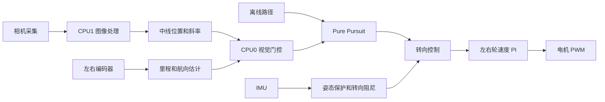
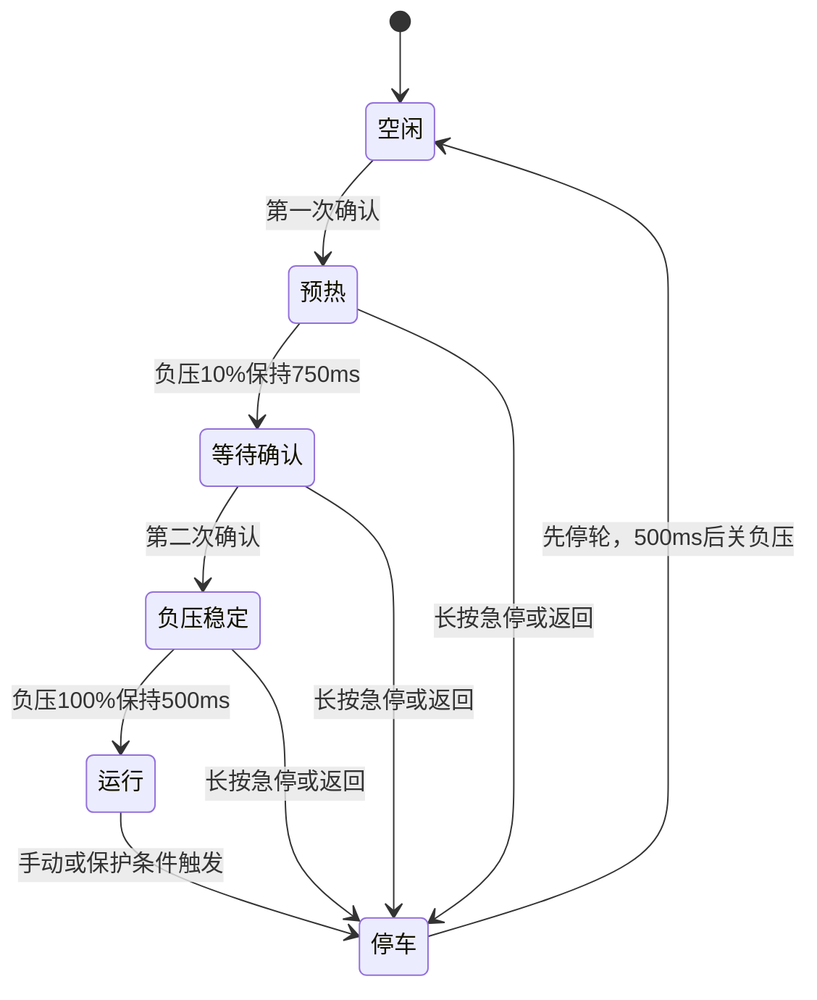
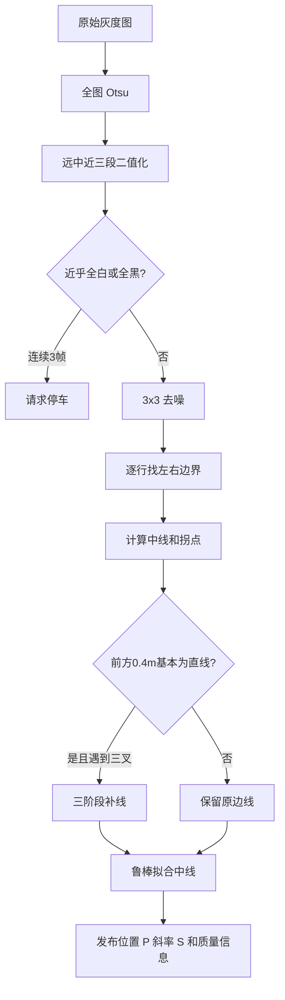
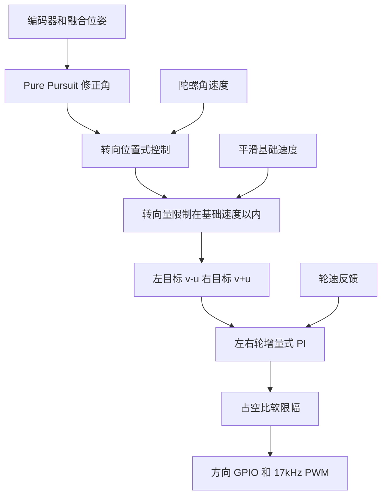

# 区赛代码说明：从发车到停车

这版区赛程序的主线其实不复杂：地图负责带路，编码器负责估计车走到了哪里，摄像头负责在合适的直道上把位置往赛道中线拉一拉。最后由 Pure Pursuit 算出该往哪边转，再交给左右轮速度环执行。

所以它不是传统的“摄像头看到中线，然后直接算左右轮差速”。图像里的找边线、补线和中线拟合都还在，但输出只是一个视觉观测。车真正怎么转，始终由地图导航决定。

下面按车辆实际运行顺序说明。文件位置都以本工程根目录为基准。

## 车跑起来以后，数据是怎么走的



CPU1 只处理相机。每帧做完后，它把中线位置、斜率、拟合误差和捕获时间放进跨核邮箱。CPU0 在 1 ms 控制中断里推进导航，读取这个邮箱，但不会无条件相信摄像头：帧太旧、拟合质量差、不在地图指定区域、车头偏角太大，都会直接丢掉。

编码器同时承担两个任务。左右轮平均脉冲用来算前进距离，左右轮差分脉冲用来算航向。地图导航得到当前位置后，向前找一个目标点，算出转向修正角。这个角度经过转向控制，才变成左右轮不同的目标速度。

对应入口主要在 `user/cpu1_main.c:17`、`code/camera_pipeline.c:209`、`code/navigation.c:611` 和 `code/control.c:256`。

## 上电和发车

CPU0 上电后依次读取 Flash 参数、加载相机标定记录、初始化菜单、电机、控制器、IMU 和导航。`nav_init()` 默认装载路线 0。紧接着调用一次 `nav_start()`，是为了停车状态下可以手推车辆，在图像调试页观察里程和导航进度，并不会让电机启动。

CPU1 等双核初始化屏障通过后再初始化 MT9V03X。相机最多重试 3 次，然后进入图像处理循环。

IMU 上电后会在中断中做一次约 1 秒的零偏采样。这次校准是在风机未启动时完成的，后面发车不会重新校准，只会把航向归零并重设 roll/pitch 的保护基准。因此上电后的最初 1 秒不要晃车。

发车需要按两次确认键：



正式进入运行状态时，程序会清上一圈的 PID 状态、编码器残留、里程和停车请求，开启 1 ms 控制中断，再用 320 ms 把基础速度从 0 平滑升到 350 cm/s。导航会话也在这里重新开始，所以推车调试留下的位置不会带进正式比赛。

这里有两个状态不要混用。`is_car_running` 在第一次确认、刚开始负压预热时就会置 1，它表示发车流程已经占用了车辆；只有 `prestart_is_running()` 才表示左右轮已经进入正式运行。运行期保护通常会同时检查这两个条件。

相关代码在 `user/cpu0_main.c:21`、`code/key.c:1171`、`code/prestart.c:49` 和 `code/control.c:156`。

## 摄像头做了什么

相机图像是 150×80。VSYNC 到来时，CPU0 同时记录场序号、毫秒时间和这一刻的纯陀螺航向。DMA 完成后，CPU1 从乒乓缓冲复制图像。如果 CPU1 已经落后两场，旧帧对应的时间信息会被覆盖，这时程序直接丢掉旧帧去追最新帧，不让流水线卡死。

采集元数据和视觉观测都用了双槽、发布序号和内存屏障。这样 CPU0 不会在 CPU1 写到一半时读到一组拼接的数据。实现见 `code/camera_pipeline.c:84` 和 `code/globals.c:46`。

一帧图像的处理顺序如下：



Otsu 当前每帧都算一次。阈值最后限制在 35～75，远端和中段直接使用 Otsu 值，近端加 5。二值图生成后做一次比较保守的 3×3 去噪，只处理孤立白点和白区小黑孔。

全白/全黑保护用的是去噪前的统计。白像素不超过 1%，或者达到 99%，都算极端候选帧；连续 3 帧才发停车请求，避免单帧曝光变化误停。

找线时，每一行分别寻找左右边界，再取平均得到中线。三叉路口会破坏正常边线，因此代码里还有一个三阶段补线状态机：路口在远端时用近端实测线外推，进入画面中间后连接底部锚点和顶部开口，靠近车身时再用远端实测线向下补。它只有在地图判断前方 0.4 m 基本是直线时才允许工作，遇到真正的弯道就退出。

补线完成后，程序从第 16～50 行隔行采样中线。拟合不是简单平均，而是先用点对斜率中位数和残差 MAD 找出大致方向，再从候选线中挑内点多、覆盖范围大、误差小的一条，最后只对内点做最小二乘。当前至少需要 8 个有效行，远端和近端各要有 3 行，内点比例不低于 50%。

这些处理最终只产生两个主要测量：中线在参考行的位置 `P`，以及中线斜率 `S`。算法实现集中在 `code/image.c:220`、`code/image.c:562`、`code/image.c:902` 和 `code/vision_fusion_math.h:255`。

## 摄像头如何修正导航

导航的基础位置来自编码器：

```text
Δs = (pulseL + pulseR) / 2 × DIST_PER_PULSE_MM
x += Δs × cos(θ)
y += Δs × sin(θ)
```

当前 `θ` 不是陀螺积分，而是编码器差速航向：

```text
Δθ = (ΔpulseL - ΔpulseR) × 0.00799°
```

源码中 `GYRO_YAW_SOURCE_ENCODER_ONLY` 为 1，`GYRO_SLIP_CORRECTION_ENABLE` 为 0。因此打滑时切换陀螺的代码虽然还保留着，这一版并没有启用。

CPU0 每 1 ms 保存一次位姿，环形缓冲一共留 32 个。摄像头观测到达后，程序按 `capture_ms` 找回拍照那一刻的位置，在历史位置上计算误差，而不是用一张旧图直接修正当前车位。这部分是图像延迟补偿。

一帧观测要依次通过这些条件：

1. 必须属于本次发车后的导航会话。
2. 从捕获到使用不能超过 20 ms。
3. 中线位置、拟合、覆盖范围和边线质量标志必须全部有效。
4. 必须能找到捕获时刻的历史位姿。
5. 车辆必须位于地图导出的视觉区内，而且进入区间 100 mm 后才开始用，距区尾 350 mm 时提前停止。
6. 不能落在地图的禁校区。
7. 当前车头与路径航向相差不能超过 20°。
8. 视觉位置与编码器位置的横向差不能超过 250 mm。
9. 以上条件要连续通过 2 帧。

通过后，程序把像素偏差按实测的 2.17 mm/px 换算到路径法向。修正不会一步跳过去，而是限制在 500 mm/s 的注入速度内：

```text
step = clamp(innovation, ±500 mm/s × frame_dt)
pose += path_normal × step
```

也就是说，摄像头只能缓慢调整“程序认为车在哪里”，不会直接改变轮速。普通丢线时这一帧被拒绝，车辆继续依靠编码器和地图运行。

相机还可以参与航向修正，但这不是默认行为。标定页面用 `(P, S, 纯陀螺航向)` 拟合一个经验模型：

```text
tan(camera_heading) = intercept
                    + position_gain × (P - P0)
                    + slope_gain × (S - S0)
```

这不是相机内参、畸变或 IPM 标定。新模型保存到 Flash 后会先保持关闭，只有菜单再次明确开启，才会用较小增益慢慢调整 `heading_bias`。

融合代码在 `code/navigation.c:286`、`code/navigation.c:349` 和 `code/navigation.c:392`；相机航向模型在 `code/calibration_math.h:32` 和 `code/calibration.c:666`。

## 地图导航和电机控制怎么接起来

离线路径保存在 `code/nav_path.h`，采样间隔是 5 mm。每个点都有 x、y 和相对发车方向的航向。车辆每 1 ms 从上一次进度开始，只向前搜索 200 mm 范围内的最近点。路径索引不回退，这样在自交或折返位置不容易跳到另一段路线。

找到最近点后，再取前方 150 mm 的点作为追踪目标，把目标变换到车体坐标：

```text
forward = dx × cos(θ) + dy × sin(θ)
lateral = -dx × sin(θ) + dy × cos(θ)
correction = atan2(lateral, forward)
```

这个 `correction` 就是 Pure Pursuit 给出的转向角。后面的控制链如下：



转向控制不是普通的线性 PID，它还有一个大误差增强项和陀螺角速度阻尼：

```text
u = KP × e + KP2 × e × |e| + KD × Δe + GKD × gyro_z
```

左右轮再分别使用增量式 PI：

```text
Δu[k] = KP × (e[k] - e[k-1]) + KI × e[k]
```

PI 算出的增量会累加到 PWM，占空比先受 `max_duty_limit` 限制，再交给电机驱动。转向量本身最多等于当前基础速度，所以左右轮目标不会因为一次转向命令变成负数。

发车加速使用 `3s² - 2s³` 的平滑曲线，起点和终点斜率都是 0。相关实现见 `code/navigation.c:632`、`code/navigation.c:677`、`code/control.c:127`、`code/control.c:256` 和 `code/PID.c:36`。

## 什么情况下会停车

安全请求大多在不同中断或 CPU1 中产生，最后由 CPU0 的 `Duty_10ms()` 统一消费。同一个 10 ms 周期内，实际判断顺序是：

1. 上位机助手急停。
2. 100 ms 没有新的已处理图像帧。
3. 电机占空比已经达到软限幅的 70%，但编码器反馈仍接近 0，累计约 100 ms。
4. 地图路径已经跑到末点。
5. 连续 3 帧近乎全白或全黑。
6. 相对发车姿态的横滚超过 ±50°。
7. 相对发车姿态的俯仰超过 ±50°。

图像页短按确认、长按确认也可以手动停车。运行到 11 秒时，5 ms 发车状态机会先关左右轮；到 12 秒还没有正常结束，就记录超时并进入停车流程。

`prestart_stop()` 先停止导航和 1 ms 速度环，立即把左右轮 PWM 清零，但保留负压。500 ms 后再关闭负压并回到空闲状态。这样停车时不会因为吸附突然消失而立刻点头。

有一个例外：从图像页按返回时，按键代码调用 `prestart_stop()` 后又马上调用 `control_disable()`，负压会立即关闭，没有等待这 500 ms。

保护代码主要在 `code/task.c:282`、`code/control.c:328`、`code/image.c:1073` 和 `code/prestart.c:80`。

## 现在到底启用了哪些东西

| 项目 | 当前情况 |
|---|---|
| 地图 Pure Pursuit | 正式转向主线，始终使用 |
| 视觉横向修正 | `NAV_VISION_FUSION_ENABLE=1`，已开启 |
| 纯摄像头直接循迹 | 没有这套运行模式 |
| 编码器航向 | `GYRO_YAW_SOURCE_ENCODER_ONLY=1`，当前使用 |
| 打滑时陀螺顶替 | `GYRO_SLIP_CORRECTION_ENABLE=0`，已关闭 |
| roll/pitch 停车 | `ATTITUDE_STOP_ENABLE=1`，已开启 |
| 3×3 图像去噪 | 已开启 |
| 相机航向融合 | 取决于 Flash 模型和菜单开关，新模型默认关闭 |
| 三叉补线 | 正在使用，但受地图前方直线判断限制 |
| 路口 `CROSSING` | 目前只计数和显示，没有拿来重置导航 |
| `SIDE_OPEN` | 只作诊断，不再直接否决观测 |
| `NAV_NOCAL_TABLES` | 逻辑已编译，但当前六条路线的禁校区数量都是 0 |
| `prestart_gyro_update()` | 兼容调用点，函数体为空 |
| 助手示波器和 IMU 周期打印 | 宏关闭 |

`nav_path.h` 中一共生成了 6 条路径，但工程里没有外部代码调用 `nav_select_path()`。初始化固定执行 `nav_load_path(0)`，因此目前实际跑的是路线 0，其他 5 条只是编进了固件，还没有选择入口。

源码注释提到的旧方案——直道由摄像头直接握盘、弯道交给惯导，以及识别路口后一次性对表——都已经撤销。当前找线代码存在，不等于还存在一套可切换的循迹驾驶模式。说明在 `code/navigation.h:34`，路线装载在 `code/navigation.c:207`。

## 接手调车时先看这几处

Flash 参数需要先确认。程序启动会优先读取车上保存的参数，源码默认值不等于比赛时实际值。尤其是源码里的转向 `KP/KD/KP2/GKD` 默认全为 0；如果车能正常转向，说明依赖的是 Flash 里已经调好的值。不要只看 `flash.c` 默认值就判断实车参数。

`loop.err_flag` 不是安全看门狗。CPU0 主循环来不及清 `check_flag` 时，它只累计一次错误，没有任何地方根据这个值停车。软件任务也不会补跑漏掉的周期。

`NAV_STATE_ERROR` 同样没有停车消费者。如果路径数据无效，转向修正可能保持为 0，车会继续直行，直到其他保护或 12 秒超时。

编码器只能有一个读取者。运行时由 1 ms 控制中断读取；停车推车调试时由 Duty_10ms 读取。切换依靠 `control_mode`、PIT 开关和短临界区保证，其他模块不要再直接读一次计数，否则会破坏增量。

最后，`MaxDuty` 目前不在持久化参数结构里，重启后会回到源码默认的 9999。Flash 结构中还留有一些旧字段，但当前控制没有读取它们。调参时应以 `control.c` 的实际调用为准，而不是只看 Flash 结构里有哪些名字。

常用入口：

- 发车和停车：`code/prestart.c`
- 后台保护：`code/task.c`
- 图像处理：`code/image.c`
- 视觉融合与 Pure Pursuit：`code/navigation.c`
- 速度和转向控制：`code/control.c`、`code/PID.c`
- 航向来源：`code/gyroscope.c`
- 路径数据：`code/nav_path.h`
