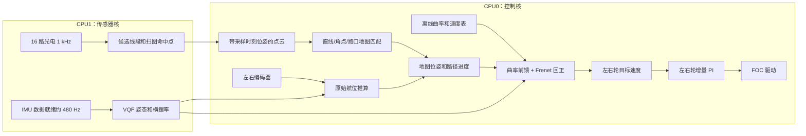
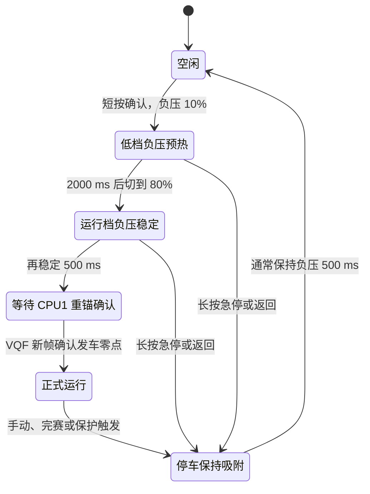
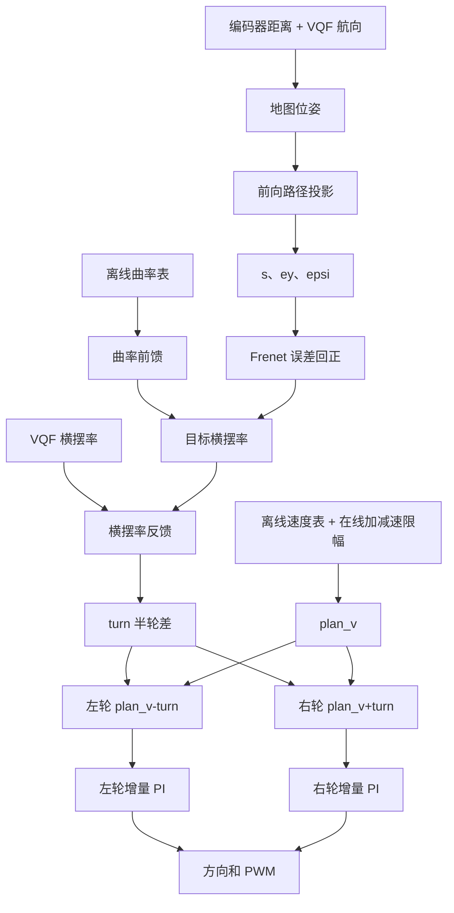

# 国赛代码说明：光电扫图、地图定位和闭环控制

这版国赛程序和区赛不是同一套循迹方法。区赛用地图 Pure Pursuit，摄像头只做横向修正；国赛则由离线地图直接给出曲率和速度，VQF 提供航向、横摆率，16 路光电把赛道上的线路扫成点云，再用点云修正地图位置。

有两个地方最容易看错：

- 光电管没有直接生成左右轮差速。它的输出用于定位、遥测和连续无线路响应保护。
- `competition_config.h` 里还留着一些 `NAV_PP_*` 名字，但 v17 已经不用 Pure Pursuit 目标点来转向。这些量只服务于路径投影、地图接管区和旧日志兼容。

当前固件固定使用 `nav_path.h` 中的路线 0。这是一条盲盒任务路线，共 9376 个 5 mm 采样点，约 46.88 m；地图导出的最高速度是 420 cm/s。车端没有路线选择入口，也不会在地图速度无效时换一套默认速度继续跑。

下面按实车从上电、发车、运行到停车的顺序说明。文件位置都以本工程根目录为基准。

## 程序跑起来以后，两颗核各管什么



CPU0 是控制核。它初始化 Flash、菜单、电机、导航、扫图缓存和 EMEM 日志；正式运行时，1 ms 硬中断读编码器、推进导航、算左右轮目标、执行速度 PI。5 ms 后台任务处理安全裁决和按键，10 ms 后台任务处理点云地图匹配。

CPU1 是传感器核。IMU 数据就绪中断大约 480 Hz，里面更新 VQF；主循环按 1 kHz 扫完 16 路模拟光电。CPU1 是这些传感器状态的唯一写者，CPU0 只读已经完整发布的快照和队列，不能直接碰 VQF 内部对象。

几个周期的职责如下：

| 周期 | 所在位置 | 实际工作 |
|---|---|---|
| IMU 数据就绪，约 480 Hz | CPU1 最高优先级外部中断 | 读 IMU、更新 VQF、处理上电零偏和发车重锚、发布姿态快照 |
| 1 ms | CPU1 主循环 | 切 MUX 扫 16 路 ADC，生成光电观测和扫图命中点 |
| 1 ms 硬中断 | CPU0 | 编码器测速、航位推算、导航、左右轮速度 PI、堵转快切 PWM |
| 1 ms 软件节拍 | CPU0 主循环 | 当前只更新光电线路诊断 |
| 5 ms | CPU0 | 发车状态机、安全保护、实体按键和菜单 |
| 10 ms | CPU0 | 上位机参数、停车推车里程、点云地图匹配和执行时间统计 |

启动入口在 `user/cpu0_main.c:23`、`user/cpu1_main.c:16`，中断分配在 `user/isr.c:17`。

## 按下发车以后发生了什么

开机默认进入光电调试页，并先调用一次 `nav_start()`。这只是为了停车时可以手推车，看实时光电、里程和地图进度，不会开启电机。停车状态下编码器由 10 ms 后台任务读取；正式发车后，编码器所有权转给 1 ms 控制中断，两个地方不会同时读。

IMU 上电后先做一次静止零偏采样，有效窗口约 1 秒。如果这段时间编码器检测到移动，或者 IMU 不够稳定，当前窗口会作废重来。发车时不会在风机振动下重新估计零偏，只在一帧真实的 VQF 结果上把当前航向设为 0，同时重设 roll/pitch 保护基准。

默认发车只按一次确认键：



第一次按键前，`prestart_begin()` 会检查三件事：IMU 服务和上电零偏已经就绪、地图及定位特征表完整、Flash 中的速度 PI 参数有效。任一项失败都不会打开电机和负压。

负压稳定后，5 ms 中断只置一个待发车标志，真正的切换在 CPU0 主循环完成。CPU0 先向 CPU1 发布“发车重锚”命令，等 CPU1 在下一帧 VQF 上执行并回传确认，然后才在一个短临界区内完成这些操作：

1. 清速度 PI、编码器残留、里程和上一轮停车请求，开启 1 ms 控制中断。
2. `nav_start()` 清原始里程计、地图修正量和路线进度。
3. 进入 `PRESTART_RUNNING`。
4. 打开光电扫图，重建采样 epoch、点云入口和位姿历史。
5. 激活本轮 EMEM 遥测会话并写入 `RUN_START`。

这样做是为了避免速度环先跑起来，CPU1 的航向零点却还是上一轮。实现集中在 `code/prestart.c:338`、`code/prestart.c:517` 和 `code/prestart.c:614`。

## 16 路光电一帧是怎么处理的

阵列由 4 根 MUX 地址线选通，Y0 对应车体左侧。每路切换后等待 3 μs，再取 2 次 ADC 均值。16 路全部扫完才算一帧，目标频率是 1 kHz。

当前把 `ADC <= 2047` 视为有线路响应，强度按下面的方向归一化：

```text
strength = (4095 - adc) / 4095
```

相邻且强度不低于 0.20 的通道先合成一个候选。候选中心不是简单取首尾平均，而是用各通道强度做加权质心，同时记录宽度、方差和信号总量。

当一帧只有一个候选时可以直接选中。出现多个候选时，程序会根据上一帧的中心、宽度和这段时间的航向变化，预测这帧应该落在哪里；中心跳动超过 24 mm、宽度变化超过 16 mm，或者前两名太接近，都会判成歧义，不硬选其中一个。跟踪状态最多保持 60 ms。

一帧会分成两类输出：

- “线路观测”只给调试页和连续无线路响应保护使用，里面有中心偏移、有效通道数、覆盖率和歧义标志。
- “扫图命中点”用于后面的点云定位。单候选会发布中心点和低权重边界点；多候选会分别发布中心；全覆盖帧会沿阵列发布若干代表点，让角点和路口几何仍能被保留。

覆盖率达到 90% 时记为全覆盖。按 16 路整数统计，实际要至少 15 路有效。全覆盖不会被当成一条唯一中线，但会作为结构特征点进入扫图。

CPU1 写队列时先写载荷、最后写发布序号；CPU0 复制前后再核对序号。发车和停车还会切换一个单调变化的 run epoch，所以跨在发车边界上的旧帧不会混进新一轮点云。

处理入口在 `code/phototube_array.c:89`、`code/phototube_array.c:435` 和 `code/phototube_array.c:643`。

## 光电点云如何把位置拉回地图

光电阵列装在车轴前方 98.5 mm。CPU0 每个 1 ms 控制周期保存一份原始里程计位姿，收到光电帧后按 `capture_ms` 插值回采样时刻，再把每个横向命中点变换到本轮原始里程计坐标系：

```text
sensor point = axle pose at capture time
             + rotate(body, [98.5 mm, lateral_mm])
```

位姿太旧、找不到采样时刻、epoch 不一致的帧直接丢掉。传感器物理位置移动不足 5 mm 时也不重复加点。在线环形缓存最多留 1280 个点，写满后覆盖最旧点；完整原始记录还会限量写入 EMEM，停车后可以导出复盘。

```mermaid
flowchart TD
    A[CPU1 发布一帧命中点] --> B{epoch 属于本轮?}
    B -- 否 --> DROP[丢弃并计数]
    B -- 是 --> C[按 capture_ms 找历史位姿]
    C --> D{位姿年龄不超过 15 ms?}
    D -- 否 --> DROP
    D -- 是 --> E[换算为原始里程计点云]
    E --> F{传感器移动至少 5 mm?}
    F -- 否 --> DEDUP[空间去重]
    F -- 是 --> G[写入 1280 点在线环]
    G --> H[10 ms 地图匹配]
    H --> I{附近有完整角点或路口?}
    I -- 是 --> J[粗到细搜索 + 鲁棒 SE(2) 求解]
    I -- 否或匹配失败 --> K[最近 120 mm 直线鲁棒拟合]
    J --> L[检查内点、RMS、进度和修正幅度]
    K --> L
    L -- 通过 --> M[发布待提交定位事务]
    M --> N[下一次 1 ms 导航中断原子提交]
    N --> O[更新地图变换并重新投影进度]
```

地图匹配先看最近约 1 m 的点云，优先尝试地图里明确标注的角点或路口。特征求解不是拿第一个点硬配最近边，而是先在平移、旋转窗口内粗搜，再细搜，最后对固定对应关系做鲁棒 SE(2) 求解。两侧/多侧证据不足、特征进度歧义、内点权重太低、RMS 没有改善，都会拒绝这次修正。

完整特征不成立时，才退回普通直线拟合。直线只用最近 120 mm 的中心线点，先按法向残差做加权众数选择，再用中位数和 MAD 清异常点，最后估计垂直于直线的平移和方向误差。直线修正只融合 35%，并把单次车辆位姿跳变量压在 8 mm 内；沿直线方向本来就不可观，所以不会假装从一条直线里解出完整位置。

匹配器在 10 ms 后台运行，最坏时会扫很多点，不能直接改 1 ms 中断正在使用的导航状态。它只发布一份“修正事务”；下一次 `nav_update()` 会重新读取当下的原始位姿和进度，在短临界区里同时提交：

- `map_from_odom` 的平移和旋转；
- 修正后的地图位姿；
- 重新投影得到的路线进度、横向误差和航向误差；
- 对应的速度段、加速度段游标和定位序号。

这里没有把历史编码器轨迹原地改写。原始里程计一直保留，点云定位改的是“原始里程计坐标如何变换到地图坐标”。这让日志里可以同时对比 raw pose 和 map pose，也避免后台定位和实时积分互相覆盖。

相关实现见 `code/task.c:381`、`code/phototube_scan.c:292`、`code/navigation.c:2512`、`code/navigation.c:3734`、`code/navigation.c:4971` 和 `code/navigation.c:5591`。

## 地图导航如何变成左右轮速度

正常比赛时，车轴前进距离来自左右编码器平均值，航向来自 VQF，而不是编码器差速积分：

```text
Δs = (Δleft + Δright) / 2
x += Δs × cos(yaw_vqf)
y += Δs × sin(yaw_vqf)
```

地图位姿经过路径投影后，得到路线进度 `s`、横向误差 `ey` 和航向误差 `epsi`。进度只向前推进，投影搜索窗有限；如果投影失败，程序进入 `NAV_STATE_ERROR`，不会切到全图搜索或另一套循迹策略继续跑。

转向由四部分接起来：

```text
omega_ff  = v_actual × kappa(s + v_actual × 35 ms)
omega_cmd = omega_ff - K_heading × epsi - K_cross × ey / max(v_actual, v_min)
turn_ff   = -(wheel_track / 2) × omega_cmd
turn_fb   = K_rate × (omega_measured - omega_cmd)
turn      = turn_ff + turn_fb
```

`omega_ff` 是离线曲率前馈；`epsi` 和 `ey` 负责把真实偏离地图的车拉回来；VQF 横摆率反馈负责抑制跟踪误差。35 ms 在当前 4.2 m/s 附近约等于 147 mm 的空间提前量。

控制链如下：



速度不是 Flash 里的固定值。`nav_path.h` 的离线速度表已经包含曲率限速、前后向加减速包络和盲盒终点制动；车端只按实测 1 ms 周期施加 3000 cm/s² 加速、5000 cm/s² 减速的时间域限幅，防止地图段切换或定位重投影造成目标阶跃。运行中读到低于 50 cm/s 的非终点速度，会被当成坏地图并停车，不会回退到旧的全局 `speed`。

高速大横摆时还有一层滑移阻尼。车速超过 300 cm/s、VQF 横摆率超过 600°/s，并且编码器差速推算的横摆率和 VQF 相差超过 250°/s 时，程序按真实车身横摆方向增加反向阻尼，最大附加半轮差 25 cm/s；差值回到 180°/s 以下才解除，避免在阈值附近抖动。

最后的左右轮目标不会小于 0，但速度 PI 的累计 PWM 是有符号的。因此到达终点、轮速目标切到 0 后，PI 可以跨过 0 施加短暂反向力矩做主动制动。这版没有电机逆模型、速度前馈或防反转门，内环就是纯增量 PI，参数来自 Flash。

导航和控制入口在 `code/navigation.c:6002`、`code/navigation.c:6292`、`code/control.c:76`、`code/control.c:384`、`code/control.c:530` 和 `code/control.c:759`。

## 哪些情况会让车停下来

保护不是全部挤在一个 10 ms 函数里。堵转在 1 ms 控制中断中确认后当拍清 PWM；其他条件主要由 5 ms 安全任务裁决，10 ms 地图匹配前还会再查一次，保证重计算不会挡在停车前面。

5 ms 安全链一次只认领一个原因，当前顺序是：

1. 连续没有任何有效线路响应达到 200 mm。只有最近 400 ms 内有可信地图匹配，而且车辆正处于地图导出的接管区时，这段距离才不累计。
2. 直线速度测试完成。正常比赛宏为 0，这一项不会触发。
3. CPU1 IMU/VQF 快照硬过期超过 10 ms。
4. 路径投影或地图参考错误，导航进入 `NAV_STATE_ERROR`。
5. 任一侧电机堵转请求。
6. 末端主动制动已经把轮速压到阈值内。
7. 路径到达末点，开始主动制动。
8. 相对发车姿态的横滚超过 ±50°。
9. 相对发车姿态的俯仰超过 ±50°。

上位机助手急停在 10 ms 参数解析时直接调用停车，不走上面这条 `else if` 链。短按确认可以手动停车，长按确认是无条件急停。

堵转条件是高 PWM、目标轮速不低于 120 cm/s，同时实际轮速低于目标的 40%（或方向相反），连续 60 ms。发车前 150 ms 有宽限，避免起步瞬间误判。确认后，1 ms 中断先把左右轮物理输出清零并锁住请求，后台随后记录 `MOTOR_FAULT`、冻结日志；这个故障还会立即关负压，避免吸附继续把已经卡住的轮子压死。

普通停车先停 1 ms 速度环和车轮，关闭本轮扫图 epoch，把队列和待提交定位事务有界收尾，再冻结 EMEM 日志。负压继续保持 500 ms 后才关。路径正常结束时则先把目标速度设成 0，让速度 PI 主动刹车；轮速不高于 5 cm/s 并持续 20 ms，或者等待满 300 ms，才进入普通停车阶段。

从光电页按“返回”是个例外：按键代码在 `prestart_stop()` 后紧接着调用 `control_disable()`，负压会立即关闭，不走 500 ms 保持。现场只是想正常停车时，应短按确认；返回键更接近退出页面并彻底断控制。

保护链在 `code/task.c:634`、`code/task.c:998` 和 `code/control.c:583`；停车事务在 `code/prestart.c:394` 和 `code/prestart.c:468`。

## 当前生效、可切换和仅保留的代码

| 项目 | 当前情况 |
|---|---|
| v17 曲率前馈 + Frenet 回正 + VQF 横摆率闭环 | 正式转向主线，正在使用 |
| Pure Pursuit 目标点转向 | 已不使用；`NAV_PP_*` 只剩投影、接管区和兼容用途 |
| 光电直接循迹 | 没有这套运行模式 |
| 16 路光电自动扫图 | `PHOTOTUBE_SCAN_AUTO_RUN=1`，正式发车自动开启 |
| 直线/角点/路口点云定位 | 正式定位主线，依赖 `nav_path.h` 导出的特征表和校准掩码 |
| 单路线协议 | `NAV_PATH_COUNT=1`，固定路线 0，没有运行时选择入口 |
| 盲盒路线 | `NAV_ROUTE_BLIND_BOX=1`，终点速度包络由地图提前制动 |
| 地图接管区 | 已导出 60 段；仅在近期定位可信时暂停无线路距离累计 |
| VQF 航向 | 正常比赛使用；编码器航向只在 `ENCODER_TEST_MODE_ENABLE=1` 时替代 |
| 高速滑移阻尼 | 正常控制中始终编译并按门限自动介入 |
| roll/pitch 停车 | `ATTITUDE_STOP_ENABLE=1`，已开启 |
| 静态 EMEM 台架模式 | `PRESTART_BENCH_TEST_MODE=0`，已关闭 |
| 直线速度测试 | `PRESTART_STRAIGHT_SPEED_TEST_MODE=0`，已关闭 |
| 地图编码器诊断 | `ENCODER_TEST_MODE_ENABLE=0`，已关闭 |
| 助手示波器发送 | `ASSISTANT_SCOPE_SEND_ENABLE=0`，发送关闭；参数解析和急停仍在 |
| IMU 周期串口打印 | `IMU_DEBUG_PRINT_ENABLE=0`，已关闭 |
| 强修正二次确认参数 | 数值均为 0，只为旧配置和日志协议兼容，当前不参与确认 |

这里尤其要注意：源码里出现 `VisionPoseObservation`、`white_percent`、`NAV_PP_*` 等名字，是沿用了原工程接口，不代表国赛还藏着摄像头循迹或 Pure Pursuit 模式。判断功能是否在跑，要沿当前调用链看，不能只看变量名。

## 接手调车时先看这些地方

第一，先确认 Flash 速度 PI。当前恢复默认值是 `KP=13.010018`、`KI=0.3`、单拍增量限幅 `8000`，但实车实际使用的是已经保存到 Flash 的值。发车检查会拒绝无效或擦除后的参数。

第二，曲率提前量按空间距离理解。当前 35 ms 是针对 4.2 m/s 基线调的，约 147 mm。后面如果提速到 5 m/s，不应原样保留时间再说“提前距离没变”，应先把时间降到约 29～30 ms，一次只动 2～3 ms。

第三，光电阈值和点云匹配是两层问题。调试页看到单管强弱不正常，先查 `ADC 2047` 阈值、阵列左右方向、98.5 mm 前置量和安装角；单帧已经正常但定位仍拒绝，再看匹配拒绝原因、RMS、内点数、特征进度和校准掩码。不要直接放大 400 mm / 30° 的最大修正门限来“让它匹上”。

第四，10 ms 匹配是后台任务，但代码会统计单次耗时和超限次数。当前预算是 5000 μs，整个 Duty_10ms 预算是 10000 μs。调定位算法时要看 `nav_match_exec_max_us`、`nav_match_overrun_count` 和点云 staging 高水位，不能只看最终有没有修正。

第五，原始里程计和地图位姿要一起看。raw pose 漂了而 map pose 能拉回，说明光电定位正在工作；两者一起漂，先看 VQF 航向、轮径和采样位姿；map pose 突跳而 raw pose 连续，重点查特征误关联和修正事务拒绝记录。

第六，EMEM 日志按一次发车形成一轮会话。停车时冻结，车辆完全回到 IDLE 后，光电页再短按一次确认才请求串口导出。导出期间 CPU0 主循环走专用快路径，不再跑普通显示和匹配任务。日志相关入口在 `code/telemetry.c:1513`、`code/telemetry.c:1615` 和 `code/telemetry.c:2330`。

常用入口：

- 发车、末端制动和停车：`code/prestart.c`
- 任务调度、无线路保护和姿态保护：`code/task.c`
- 16 路 ADC 扫描和候选提取：`code/phototube_array.c`
- 点云生成和在线缓存：`code/phototube_scan.c`
- 地图匹配、路径投影和横向控制：`code/navigation.c`
- 速度规划、滑移保护和左右轮 PI：`code/control.c`
- VQF、上电零偏和跨核姿态快照：`code/gyroscope.c`、`code/globals.c`
- 赛场可调参数：`code/competition_config.h`
- 当前离线路线、速度表和特征表：`code/nav_path.h`
- EMEM 日志和串口导出：`code/telemetry.c`
